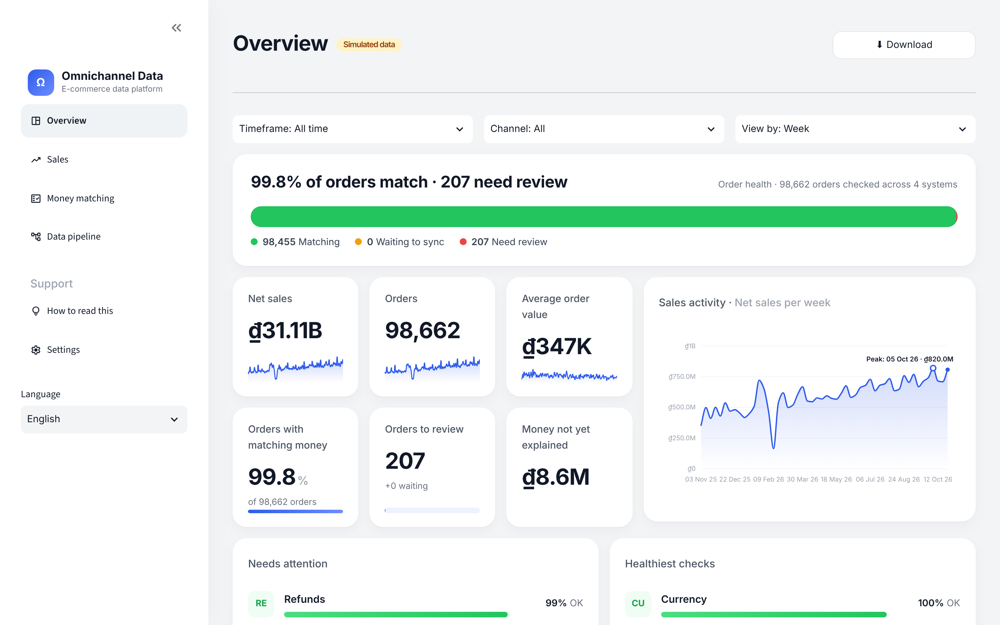
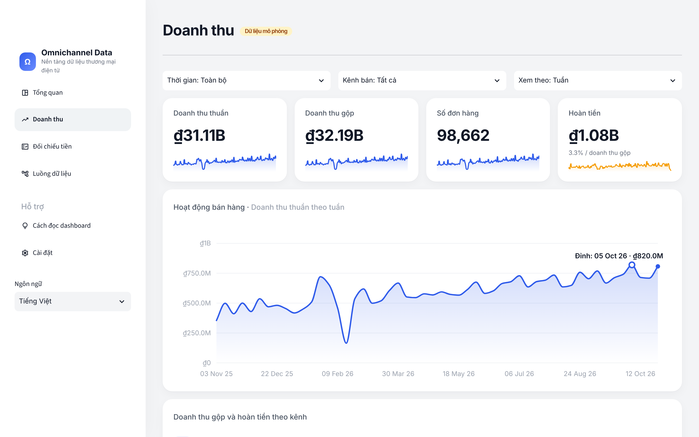
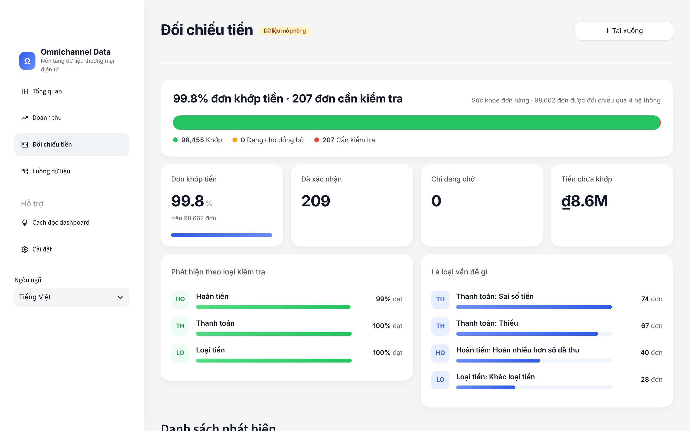
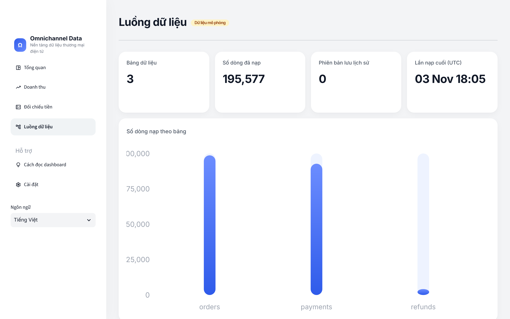
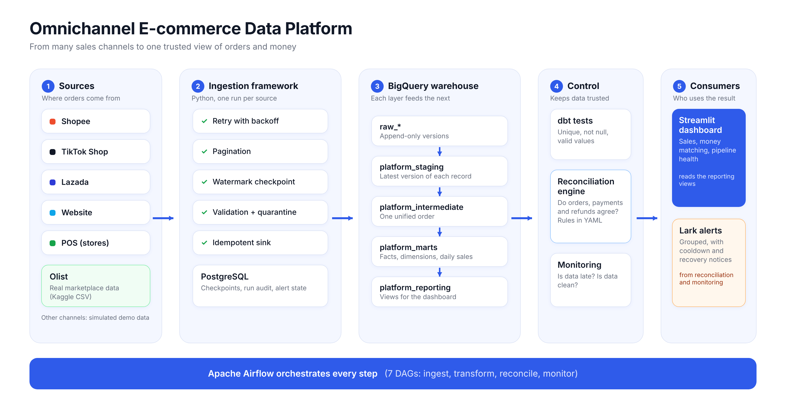
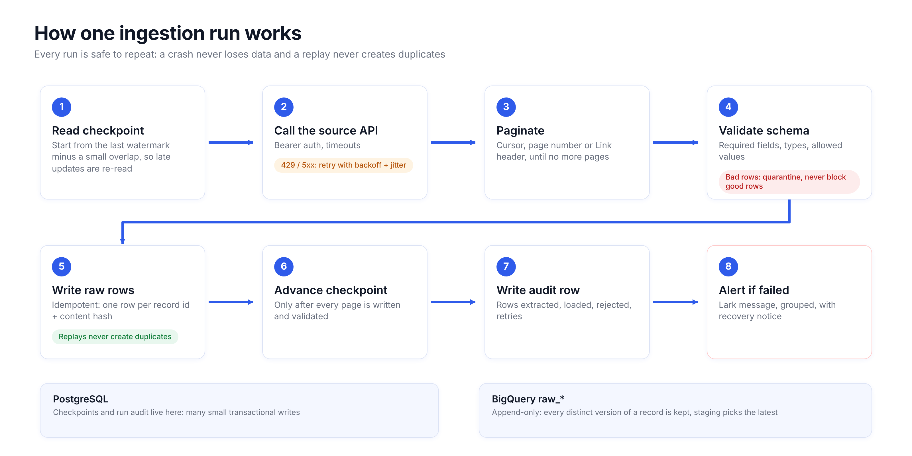
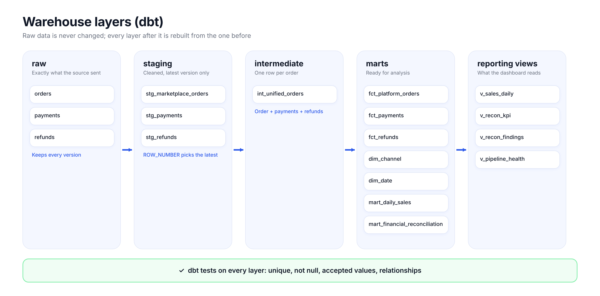
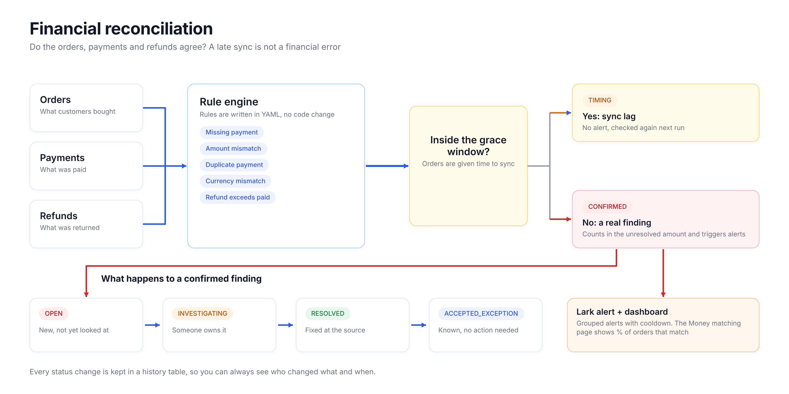
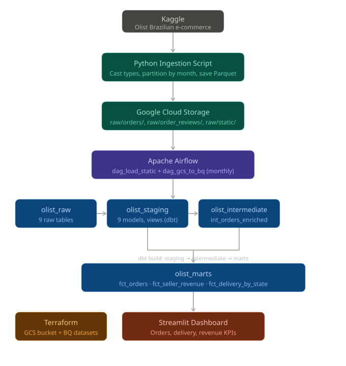
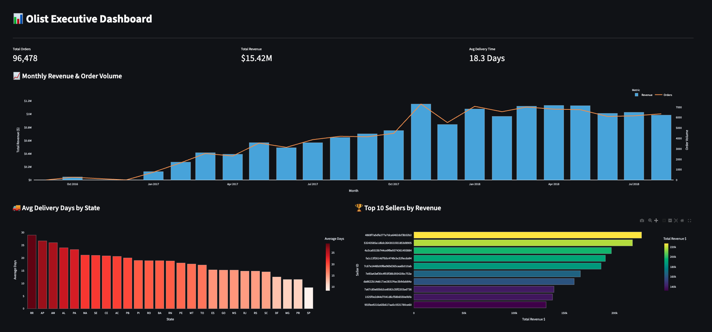

[](https://github.com/chaukydang/ecommerce-data-platform/actions/workflows/ci.yml)


# Omnichannel E-commerce Data Platform

One trusted view of **orders and money** across Shopee, TikTok Shop, Lazada, a website and physical stores.
It pulls data from sales-channel APIs, loads it into BigQuery, models it with dbt, checks that orders, payments and refunds agree,
raises alerts on Lark, and shows the result in a dashboard that a non-technical person can read.

## Live demo

**Dashboard: https://ecommerce--data---platform.streamlit.app/** (Streamlit Community Cloud, reading BigQuery with a read-only service account).

It shows a **simulated** omnichannel business (Shopee, TikTok Shop, Lazada, Website, POS stores; VND; last 12 months, ~100k orders) that
went through the real pipeline. The same pipeline also runs on **real data**: ~100k Olist marketplace orders from Kaggle.

| Overview | Sales |
|---|---|
|  |  |
| **Money reconciliation** | **Data pipeline health** |
|  |  |

## What it does

| Capability | What it does | Code |
|---|---|---|
| Ingestion framework | Bearer/OAuth/HMAC auth, cursor + page + Link pagination, 429/5xx retry with backoff and jitter, incremental watermark with overlap, schema validation + quarantine, idempotent sink, crash-safe checkpoints | `src/ecomplatform/ingestion` |
| Warehouse models | raw (append-only versions) → staging → unified order → facts, dimensions and marts, then reporting views | `dbt/olist/models/platform` |
| Financial reconciliation | 13 rules in YAML (order, payment, refund, settlement), `TIMING` vs `CONFIRMED`, exception lifecycle with history, no duplicate exceptions | `src/ecomplatform/reconciliation`, `configs/` |
| Monitoring and alerts | Freshness, data quality, run audit; Lark webhook alerts with grouping, cooldown, escalation, recovery notice and HMAC signing | `src/ecomplatform/monitoring` |
| Orchestration | 7 Airflow DAGs (4 ingest, transform, reconcile, monitor) with a failure callback | `airflow/dags/dag_platform.py` |
| Dashboard | Order-health bar, KPI cards, activity line chart, rankings; plain-language labels, Vietnamese / English switch, *How to read this* page | `streamlit_app/` |

## Architecture



### One ingestion run

Every run is safe to repeat: a crash never loses data and a replay never creates duplicates.



### Warehouse layers



### Financial reconciliation

A payment that is missing 20 minutes after checkout is sync lag, not a financial error. Only `CONFIRMED` findings count in the unresolved amount and trigger alerts.



### Key design decisions

| Decision | Why |
|---|---|
| Raw layer keeps every distinct version of a record; staging selects the latest | Replays, overlap windows and API retries cannot duplicate data, and history for late updates is preserved. |
| Checkpoint advances only after all pages are written and validated | A crash mid-run leaves idempotent rows behind and the same window is retried. |
| Operational metadata (checkpoints, alert state, exception lifecycle) in PostgreSQL, not BigQuery | Many small transactional writes are a poor fit for BigQuery. |
| Reconciliation in a Python rule engine **and** a dbt SQL mart | Python owns the exception lifecycle and alert de-duplication; the SQL mart gives BI a per-order view. A test proves both flag the same orders. |
| Free BigQuery sandbox friendly: no DML, no streaming, no partitioning on the small marts | The sandbox rejects DML and deletes partitions older than 60 days, which would empty historical data. Loads are append-only; de-duplication is a `SELECT`. |

Full list and known limits: [docs/architecture.md](docs/architecture.md).

## Data sources (profiles)

Each profile runs ingest → dbt → reconciliation → monitoring in its own datasets (`raw_<profile>`, `platform_marts_<profile>`, `platform_reporting_<profile>`), so real and simulated data never mix.

| Profile | Data | Run | Guide |
|---|---|---|---|
| `omni` | **Simulated** Shopee, TikTok Shop, Lazada, Website, POS (VND, 12 months, planted payment/refund problems) | `make omni PROJECT=...` | [omni_demo.md](docs/omni_demo.md) |
| `olist` | **Real** marketplace data, Brazil, ~100k orders (Kaggle) | `make olist PROJECT=...` | [olist_quickstart.md](docs/olist_quickstart.md) |
| `shopee` | Shopee Open Platform v2: orders, payments, settlements. Tested against a mock until a developer app is approved | `scripts/run_profile.py --profile shopee` | [shopee_quickstart.md](docs/shopee_quickstart.md) |
| `shopify` | Shopify Admin API: orders, payments, refunds. Tested against a mock | `make shopify PROJECT=...` | [shopify_quickstart.md](docs/shopify_quickstart.md) |
| default | Simulated marketplace / OMS / POS / finance APIs with 30 labelled injected discrepancies | `make demo` | [architecture.md](docs/architecture.md) |

## Quick start

**1. No cloud account** (DuckDB + local simulator):

```bash
pip install -e ".[sim,local,dev]"
make test    # 101 tests: unit, simulator + DuckDB + dbt, BigQuery fake-client and compile checks
make demo    # simulator -> ingest -> dbt -> reconcile -> monitor -> alerts, prints a report
```

**2. On your own BigQuery** (free sandbox works, see [bigquery_free_quickstart.md](docs/bigquery_free_quickstart.md)):

```bash
gcloud auth application-default login
pip install -e ".[bigquery,dashboard,olist,local]"
make omni PROJECT=your-gcp-project        # or: make olist PROJECT=your-gcp-project  (needs Kaggle credentials)
# the command prints the dashboard command, for example:
DASH_DATASET=platform_reporting_omni DASH_SIMULATED=1 DASH_CURRENCY="₫" GCP_PROJECT_ID=your-gcp-project BQ_LOCATION=US \
  python -m streamlit run streamlit_app/platform_dashboard.py
```

**3. Deploy the dashboard** for free on Streamlit Community Cloud: [docs/streamlit_cloud.md](docs/streamlit_cloud.md).

## Testing

`make test` runs 101 tests (also in CI on Python 3.11 and 3.12, with real PostgreSQL for the metadata layer). They prove behaviour, not just execution:

- the rules find **exactly** the 30 injected discrepancies, with no false positives;
- re-running a batch adds 0 rows; an outage mid-pagination leaves the checkpoint untouched and the retry recovers without duplicates;
- API tokens never appear in audit rows or alerts;
- the dbt SQL mart and the Python rule engine flag the same orders; repeated reconciliation creates no duplicate exceptions;
- repeated alerts are grouped and recovery is announced;
- every SQL statement parses in the BigQuery dialect and all platform dbt models compile for the BigQuery target.

## Tech stack

| Layer | Tools |
|---|---|
| Language | Python 3.10+ |
| Warehouse | BigQuery (DuckDB for local runs and tests) |
| Transformation | dbt Core |
| Orchestration | Apache Airflow (Docker Compose) |
| Operational metadata | PostgreSQL |
| Dashboard | Streamlit |
| Alerts | Lark webhook |
| Infrastructure | Terraform |
| CI | GitHub Actions |
| Test doubles | FastAPI mock sources (marketplace, OMS, POS, finance, Shopify, Shopee) |

## Project structure

```
src/ecomplatform/       ingestion, reconciliation, monitoring, simulators, profile pipeline
configs/                sources, reconciliation rules, freshness and data-quality YAML (per profile)
dbt/olist/              dbt project; models/platform = the omnichannel models
streamlit_app/          dashboard (platform_dashboard.py)
sql/                    BigQuery reporting views
scripts/                run_profile.py, run_local_demo.py
airflow/                DAGs and Docker Compose
terraform/              GCP infrastructure (platform.tf = raw_* and platform_* datasets)
tests/                  unit + integration (pytest)
docs/                   guides, architecture, rules, data dictionary, runbook; docs/diagrams = diagram sources
ingestion/              original Olist ingestion script
```

## Documentation

[Architecture](docs/architecture.md) · [Reconciliation rules](docs/reconciliation_rules.md) · [Data dictionary](docs/data_dictionary.md) ·
[Operational runbook](docs/operational_runbook.md) · [Deployment](docs/deployment.md) · [Benchmarks](docs/benchmarks.md) ·
[Free BigQuery](docs/bigquery_free_quickstart.md) · [Streamlit Cloud](docs/streamlit_cloud.md)

Diagrams are rendered from `docs/diagrams/build.py` (`python docs/diagrams/build.py`).

## Status and limits

| Verified | Not yet verified |
|---|---|
| Full run on a real BigQuery project (free sandbox): ingestion, 64 dbt steps, reporting views, reconciliation, monitoring; dashboard live on Streamlit Cloud | Airflow DAGs and Docker Compose stack on a real run (only parsed in tests) |
| Real data end to end (Olist, ~100k orders) | Terraform apply of `platform.tf` |
| 101 automated tests, CI on 3.11 and 3.12 | Shopee and Shopify with real credentials (connectors are tested against mocks) |
| | Lark delivery to a real workspace (alert logic is tested) |

Not built: inventory snapshots, `dim_product`, line-item facts. In the live demo the five channels are simulated; only the Olist profile is real data.

## Appendix: the original Olist batch pipeline

<details>
<summary>Kaggle → GCS (Parquet) → Airflow → BigQuery → dbt → Streamlit (upstream project, unchanged)</summary>





#### Prerequisites

- GitHub account with Codespaces access
- GCP account with billing enabled
- Kaggle account with API access

#### Setup

##### 1. Fork and add Codespaces secrets

Fork this repo. Before opening in Codespaces, go to **Settings → Secrets and variables → Codespaces** and add:

| Secret | Description |
|---|---|
| `GCP_SERVICE_ACCOUNT_KEY` | GCP service account key JSON |
| `GCS_BUCKET_NAME` | GCS bucket name |
| `GCP_PROJECT_ID` | GCP project ID |
| `KAGGLE_USERNAME` | Kaggle username |
| `KAGGLE_KEY` | Kaggle API key |

##### 2. Open in Codespaces

Open the forked repo in GitHub Codespaces. The dev container will automatically:
- Install all Python dependencies (including dbt)
- Install Terraform and Docker
- Create the .gcp directory within the airflow/ folder and write the GCP service account keyfile to airflow/.gcp/keyfile.json

##### 3. Provision infrastructure

```bash
cd terraform
terraform init
terraform plan
terraform apply
```

This creates:
- GCS bucket for raw data
- BigQuery datasets: `olist_raw`, `olist_staging`, `olist_intermediate`, `olist_marts`

##### 4. Run ingestion

```bash
python ingestion/partition_and_upload.py
```

This downloads the Olist dataset from Kaggle, partitions transactional files by month, and uploads all files to GCS as Parquet.

##### 5. Start Airflow

```bash
cd airflow
docker compose up -d
```

Access the Airflow UI at `http://localhost:8080` (username: `admin`, password: `admin`).

##### 6. Trigger DAGs

Run in this order:

1. **`dag_load_static`** — loads static dimension tables once (customers, sellers, products, order items, payments, geolocation). These never change and are not reprocessed.
2. **`dag_gcs_to_bq`** — runs monthly, loads partitioned `orders` and `order_reviews` tables, then automatically triggers `dbt build --select stg_orders+ stg_order_reviews` to transform and test only the models affected by new data.

> **Note:** After running `dag_load_static` for the first time, manually run `dbt build --select stg_customers stg_sellers stg_products stg_order_items stg_order_payments stg_geolocation stg_category_translation --target prod` once to populate static staging models in prod.

##### 7. Run the dashboard

```bash
cd streamlit_app
streamlit run app.py
```

Access the dashboard at `http://localhost:8501`.

#### Data Flow

##### GCS Structure

```
gs://<your-bucket>/
    raw/
        orders/
            orders_2016-09.parquet
            orders_2016-10.parquet
            ...
        order_reviews/
            order_reviews_2016-10.parquet
            ...
        static/
            customers.parquet
            sellers.parquet
            products.parquet
            order_items.parquet
            order_payments.parquet
            geolocation.parquet
            category_translation.parquet
```

##### BigQuery Datasets

| Dataset | Description |
|---|---|
| `olist_raw` | Raw data loaded directly from GCS |
| `olist_staging` | Cleaned and typed models — one per source table (views) |
| `olist_intermediate` | Joined and enriched models — `int_orders_enriched` |
| `olist_marts` | Business-level fact tables for dashboards |

##### dbt Models

**Staging (9 models, views)** — light cleaning and type casting on top of raw tables. One model per source.

**Intermediate (1 model)** — `int_orders_enriched` joins orders with customers and computes delivery time in days.

**Marts (3 models, tables):**

| Model | Materialization | Description |
|---|---|---|
| `fct_orders` | Incremental (insert_overwrite), partitioned by month | Row-level orders with revenue. Powers monthly order and revenue trends. |
| `fct_delivery_by_state` | Table, clustered by state | Delivery time per order per state. Powers avg delivery time KPI. |
| `fct_seller_revenue` | Table, clustered by seller_id | Revenue per order item per seller. Powers top 10 sellers KPI. |

**Data quality**: The project includes 28 dbt tests (schema tests, uniqueness, and relationship checks) that run as part of the dbt build command in Airflow to ensure data integrity before it reaches the Marts.

##### KPIs

- **Total orders and revenue by month** — sourced from `fct_orders`
- **Average delivery time by state** — sourced from `fct_delivery_by_state`
- **Top 10 sellers by revenue** — sourced from `fct_seller_revenue`

#### Pipeline Design Decisions

**Idempotency** — `dag_gcs_to_bq` deletes existing rows for the execution month before loading, making every DAG run safe to re-trigger without duplicating data.

**Incremental models** — `fct_orders` uses dbt's `insert_overwrite` incremental strategy, processing only the current month's partition on each run. Static dimension models are built once and not reprocessed.

**Storage Optimization**:
* **Partitioning**: `fct_orders` is partitioned by `order_purchase_timestamp` (monthly), enabling dbt's `insert_overwrite` strategy to replace data at the partition level, significantly reducing processing costs during backfills.
* **Clustering**: High-cardinality columns like `seller_id` and `state` are used for clustering in Marts to optimize filter performance for the Streamlit dashboard.

**Selective dbt execution** — Airflow runs `dbt build --select stg_orders+ stg_order_reviews` instead of rebuilding all models, avoiding unnecessary processing of static staging models on every monthly run.

</details>

## Acknowledgments

* **Data**: [Olist](https://olist.com/) released the Brazilian e-commerce dataset, hosted on [Kaggle](https://www.kaggle.com/datasets/olistbr/brazilian-ecommerce).
* **Community**: the upstream project was built as part of the [Data Engineering Zoomcamp](https://github.com/DataTalksClub/data-engineering-zoomcamp) by DataTalks.Club.
